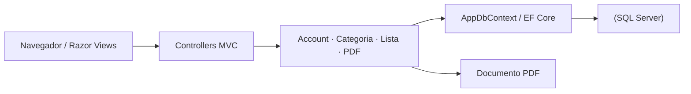

<p align="center">
  
</p>

<p align="center">Listas de compras por categoria, controle de usuários e relatórios em PDF.</p>

<p align="center">
  
  
  
</p>

<p align="center"><a href="#visão-geral">Visão geral</a> &nbsp;·&nbsp; <a href="#recursos">Recursos</a> &nbsp;·&nbsp; <a href="#como-executar">Como executar</a></p>

---

## Visão geral

Além do fluxo completo de persistência relacional com **Entity Framework Core e SQL Server**, o sistema conta com um controlador dedicado para exportação da lista de compras em **PDF**, facilitando o compartilhamento ou impressão do orçamento planejado.

## Recursos

| Recurso | Como funciona |
|---|---|
| Autenticação de usuários | AccountController com LoginViewModel e RegisterViewModel para acesso individualizado. |
| Gestão de categorias | CategoriaController permite criar e organizar setores de produtos (mercado, casa, tecnologia, etc.). |
| Controle de itens e lista | ListaController gerencia a inclusão, edição, marcação e remoção de ItemCompra. |
| Resumo financeiro | ResumoViewModel consolida totais de itens e valores acumulados no carrinho. |
| Exportação para PDF | PDFController transforma os itens selecionados em um documento pronto para download. |
| Migrações versionadas | Histórico de banco de dados gerenciado pelo EF Core Migrations (AppDbContext). |

## Tecnologias

- **C# e ASP.NET Core MVC** na arquitetura de controladores, modelos e páginas Razor;
- **Entity Framework Core (AppDbContext)** para mapeamento objeto-relacional e migrações;
- **SQL Server** como banco de dados relacional para usuários, categorias e itens;
- **ViewModels dedicadas** (LoginViewModel, RegisterViewModel, ResumoViewModel) para desacoplar as telas das entidades de banco.

<details>
<summary>Arquitetura</summary>



As requisições passam pelos controladores especializados, que validam os dados através de ViewModels e persistem o estado no SQL Server por meio do AppDbContext.

</details>

<details>
<summary>Estrutura do repositório</summary>

```text
Carrinho-de-Compras/
├── assets/
│   └── project-animal.png          Emblema do projeto
├── Buy_Cart/
│   ├── Controllers/                Account, Categoria, Home, Lista e PDF
│   ├── Data/AppDbContext.cs        Contexto do Entity Framework Core
│   ├── Migrations/                 Esquema versionado do banco de dados
│   ├── Models/                     Usuario, Categoria, ItemCompra
│   ├── ViewModels/                 Modelos de transferência para as telas
│   ├── Views/                      Interfaces Razor (.cshtml)
│   └── Program.cs                  Configuração de serviços e pipeline HTTP
├── Buy_Cart.sln                    Solução Visual Studio
└── README.md
```

</details>

## Como executar

1. Clone o repositório:
   ```powershell
   git clone https://github.com/arthurlynow098/Carrinho-de-Compras.git
   cd Carrinho-de-Compras
   ```
2. Configure a string de conexão do seu **SQL Server** em Buy_Cart/appsettings.json.
3. Aplique as migrações e inicie o servidor:
   ```powershell
   dotnet ef database update --project Buy_Cart
   dotnet run --project Buy_Cart/Buy_Cart.csproj
   ```

## Decisões técnicas

- **Separação entre Models e ViewModels:** impede overposting nos formulários de autenticação e entrega exatamente os dados agregados que a tela de resumo precisa.
- **Exportação integrada:** geração de PDF no próprio back-end garante fidelidade dos preços e quantidades registrados na sessão do usuário.

---

<p align="center">
  <a href="https://github.com/arthurlynow098">GitHub</a> &nbsp;·&nbsp;
  <a href="https://arthurentsev.vercel.app/">Portfólio</a> &nbsp;·&nbsp;
  <a href="https://www.linkedin.com/in/entsevarthur/">LinkedIn</a>
</p>
